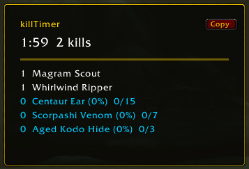

# killTimer

Live kill/time/drop-% overlay for WoW: Forever players leveling with RestedXP.



Follow the steps below to install, enable, and configure it.

## 1. Check the prerequisites

- World of Warcraft: Forever (addon interface 16001).
- [RestedXP](https://www.restedxp.com/) is optional - without it you still get the live
  overlay, just not the automatic per-step resets and logging.

## 2. Install the addon

Pick one of the two methods.

### Option A: WowUp

1. Open WowUp and check that your Forever client shows up under **Options > Clients**
   (usually auto-detected as `_forever_`; if not, add it there with **Add New**).
2. Go to **Get Addons > Install from URL**.
3. Paste `https://github.com/askau2003/killTimer` and confirm.
4. WowUp installs the latest tagged release. Once a new version is tagged, WowUp's update
   button will offer it the same way.

### Option B: Manual

1. Download the repo (`Code > Download ZIP` on GitHub, or `git clone`).
2. Copy the folder into your AddOns directory, named exactly `killTimer`:
   ```
   World of Warcraft/_forever_/Interface/AddOns/killTimer/
   ```
   It must directly contain `killTimer.toc`, `killTimer.lua` and `killTimerOptions.lua`.
3. Restart the client, or `/reload` if it's already running.

## 3. Turn it on

1. At the character-select screen, open the AddOns list.
2. Make sure `killTimer` is checked/enabled.
3. Log into a character - a small overlay panel appears on screen automatically.

## 4. Adjust the panel to your liking

1. Open **Settings > AddOns > killTimer**.
2. Drag the **Scale** slider to resize the whole panel.
3. Drag **Width** and **Height** to set a fixed panel size - content wraps/clips to it
   instead of the panel resizing itself.
4. Check **Lock position** to stop the panel from being dragged by accident.
5. Drag the panel (while unlocked) to move it, or click **Reset position** to put it back
   where it started.

## 5. Use it while leveling

1. Kills, elapsed time, and quest-item drops are tracked automatically - nothing to set up.
2. Run `/killtimer` any time to manually reset the overlay and its counters.
3. With RestedXP installed, the overlay resets itself whenever RestedXP's leveling step
   changes, and prints a summary to chat (also saved to `killTimerLog`, per character) for
   the step that just ended:

   ```
   killTimer: step 3
     2:14  87 kills
     12  Timber Wolf
     5  Mottled Boar (62%)  5/8
   ```

## 6. Share your data

Click the **Copy** button on the overlay (or run `/killtimer copy`, or use the **Copy data
to share** button under **Settings > AddOns > killTimer**) to open a small window with the
current stats as plain text. Press **Ctrl+A** then **Ctrl+C** to copy it, then paste it
anywhere (Discord, chat, etc.) - WoW addons can't write to the clipboard directly, so this
select-and-copy box is the standard workaround.

## Reporting bugs and requesting features

- [Report a bug](https://github.com/askau2003/killTimer/issues/new?template=bug_report.yml) -
  asks for the addon version, whether RestedXP is installed, and any Lua errors, which is
  normally all that's needed to track down a problem.
- [Request a feature](https://github.com/askau2003/killTimer/issues/new?template=feature_request.yml) -
  asks what problem it would solve and what you'd like to happen.

## License

[MIT](LICENSE)

## For agents

See [CLAUDE.md](CLAUDE.md) for the local testing workflow.
